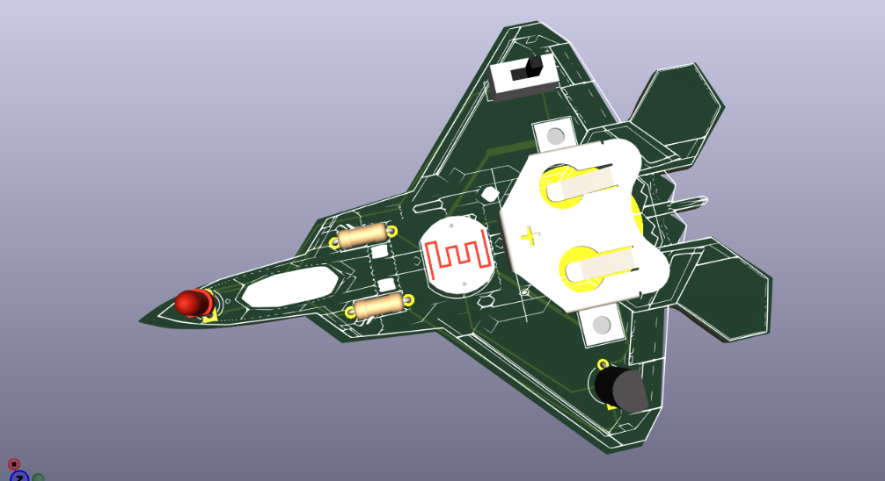
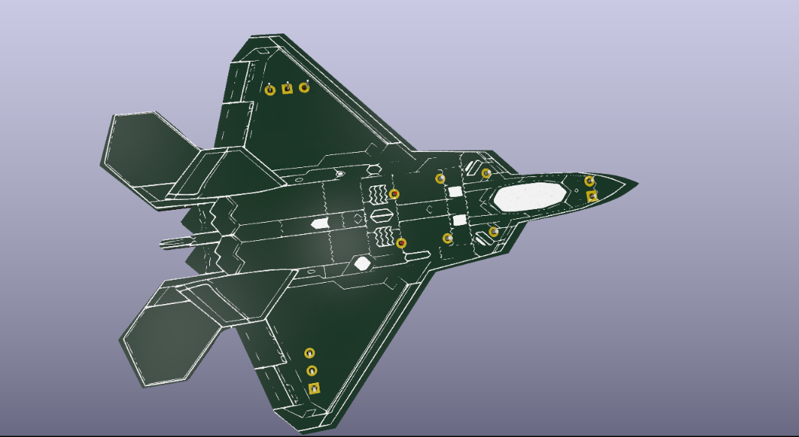

# October 31st: Making a cool idea 

today I have created a cool idea that what should i make , 

and also i learn how we can make any shape of pcb in kicad .

The shape i have selected for my pcb keychain .

**Total time spent: 1h**

# November 2nd: completed the schematics  

today I have selected all the components in schematics editor , 

and connected all the wires and also run the ERC for any error but it was all correct no error are their .

**Total time spent: 1.2h**

# November 4th: completed the pcb design  

today I have completed almost all the pcb part only thing left is a hole for key ring and some good styles on pcb ,

I have used inkscape to make the shape of the f-22 raptor using stroke ,

for help i used this yt tutorial `https://youtu.be/rhqlP8CRct0?si=SE47k9Mj8VMQZD9N`

and also the drc is ok no violation found . 

**Total time spent: ~2h**

# November 5th: Almost every thing is done  

today I have added a small spdt switch so that you can save the battery if in case it is in pocket or you want to save the battery .

I have a good graphic of f-22 raptor design . 
and also added a hole to add the keyring

i take the graphic from here : `https://upload.wikimedia.org/wikipedia/commons/6/6a/Lockheed_Martin_F-22A_Raptor_3-view.png`,

and also the drc is ok no violation found . 

I think almost everything is done .

front view

back view 

**Total time spent: ~1.5h**