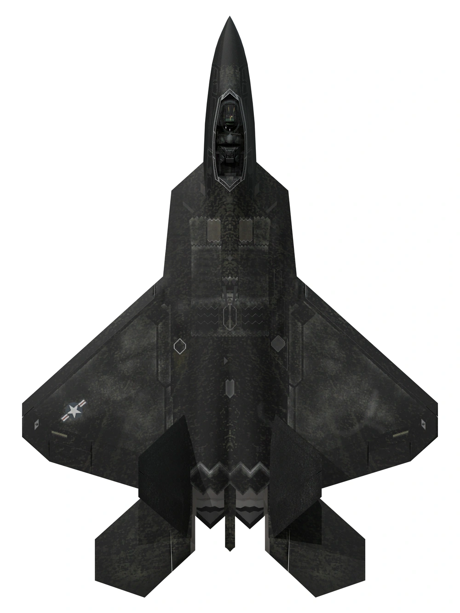

# October 31st: Making a cool idea 

today I have created a cool idea that what should i make , 

and also i learn how we can make any shape of pcb in kicad .

The shape i have selected for my pcb keychain .

**Total time spent: 1h**